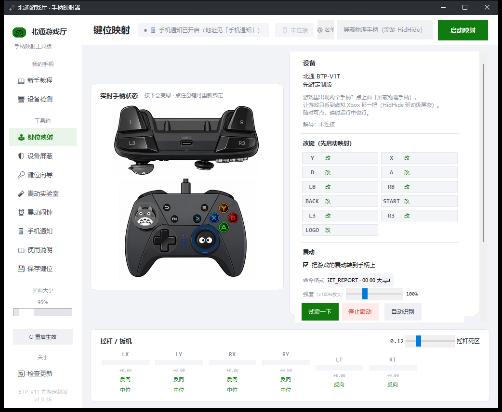

# BetopXboxMapper

**把北通 BTP-V1T（腾讯先游定制版）手柄，在系统层面变成一个真正的 Xbox 360 手柄。**

不刷固件、不改注册表、不装虚拟驱动以外的任何东西。所有只认 XInput 的游戏——
包括基岩版 Minecraft（Minecraft Bedrock / 我的世界中国版）这类微软商店里的
UWP 应用——都能直接识别并使用你的手柄。



---

## 为什么需要这东西

这把北通 BTP-V1T 是腾讯先游的定制版（USB VID `20BC`，PID `503C`，
设备名 `BETOP TCP BFM GAMEPAD`）。它的问题是：

**它在 Windows 上默认跑在 BFM（安卓）模式，对系统自称 DirectInput 手柄。**

而 Windows 上绝大多数现代游戏，尤其 UWP 应用，只认 XInput。结果就是：

- 游戏里手柄毫无反应，或者部分按键错乱
- 设备管理器和「设置 → 设备和打印机」里看它一切正常，没有感叹号
- 它不是坏了，只是说的语言不对

更糟的是——**这把定制版实测切不进北通通用的 PC360（XInput）模式**。
按官方说明操作后设备枚举完全没变化（PID 还是 503C、接口没少、XInput 设备数为 0），
大概率是固件里压根没做那个 mode。

官方的升级通道（北通智控 PC 版）支持列表里也只有鲲鹏 / 盘古 / 阿修罗系列，
没有这个定制版，且没有任何公开的固件文件和 DFU 入口。

那就只好自己来了：既然不能让手柄说 XInput，就**在系统里插一个 Xbox 手柄替它说**。

```
物理北通手柄 ──HID 原始报告──> HidP 精确解码 ──> keymap 翻译
      ↑                                                    ↓
   私有通道回写                                    ViGEmBus 虚拟 Xbox 360 手柄
   （震动转发）                                             ↓
                                                      游戏 / UWP 应用
```

---

## 功能

| | |
|---|---|
| **实时 Xbox 手柄图** | Canvas 手绘的 Xbox 布局手柄，按键按下会亮绿、摇杆帽跟着动、扳机按多深填多长 |
| **点图改键** | 鼠标点手柄图上任意一个键，就能重新绑定对应的物理按键 |
| **图形化键位向导** | 跟不上手就跑向导：图上橙色高亮提示你按哪个键，自动记录 HID usage |
| **零猜测解码** | 轴和十字键走系统 `HidP_*` API 按描述符精确定位，不是硬编码字节偏移 |
| **逐轴反向 / 校准中位** | 每个轴都能单独翻转方向，中位漂移点一下「校准中位」即可 |
| **摇杆死区可调** | 0.00 ~ 0.50 实时滑块 |
| **震动转发** | 把游戏的 XInput 震动指令，翻译成手柄私有通道命令发给物理手柄 |
| **震动强度滑块** | 0.05 ~ 3.0 倍增益，嫌游戏里震得轻就往上拉（能超过 100%） |
| **🧪 震动实验室** | 内置的命令扫描器：58 条候选挨个试，「最强对决」模式两两对比帮你挑出最猛的那条，冠军自动写进配置 |
| **📖 图形化新手教程** | 六步图解（装驱动 → 插手柄 → 认键 → 启动 → 进游戏 → 调震动），还能当场检测驱动和手柄 |
| **娱乐模式** | 一个按钮让手柄一直震着玩，再点一次停 |
| **⏰ 震动闹钟** | 到点让手柄一直震，**按手柄上任意一个键就停**（也能用扳机 / 大幅推摇杆）。内置 8 种铃声（连续 / 脉冲 / 心跳 / 渐强 / 三连滴 / 波浪 / 警笛 / SOS 摩斯），可设每天重复、响铃强度，最多震 2 分钟自动停。不启动映射也能用 |
| **🔄 检查更新** | 启动时后台静默查一次 GitHub 最新 Release，左下角显示「✅ 已是最新版」；有新版本就弹更新说明 + 内置下载器（进度条、可取消、下完直接运行安装包，也能选绿色版 zip）。更新窗口里查完会同步刷新左下角 |
| **🖥 系统托盘** | 纯 ctypes 实现（零第三方依赖）：关窗口 = 缩到托盘继续跑，右键菜单能开关映射、开闹钟、试震、检查更新、退出 |
| **单文件绿色 exe** | 打包后可免安装运行，也可以做成带开始菜单的安装包 |

---

## 快速开始

### 方式 A：直接用现成的安装包（推荐）

到 [Releases](../../releases) 页面下载 `北通手柄映射器_安装.exe`，双击安装。
第一次使用会提示安装 **ViGEmBus 驱动**（这是必装的系统级虚拟手柄总线，
由 Nefarius 开源维护），跟着点确定就行。

装完打开「开始菜单 → 北通手柄映射器」。

### 方式 B：源码运行

```bash
# 1. 装 Python 依赖（Windows 需 Python 3.8+）
pip install -r requirements.txt

# 2. 装 ViGEmBus 驱动（只需一次）
#    https://github.com/nefarius/ViGEmBus/releases

# 3. 跑起来
python gui.py
```

> **重要**：ViGEmBus 驱动必须装，否则点「启动映射」会报打不开虚拟手柄。

---

## 使用注意

1. **先启动映射，再打开游戏**。很多游戏（尤其基岩版）只在启动时扫描输入设备，
   顺序反了就得重启游戏。
2. 别通过 Steam 启动目标游戏 —— Steam Input 会把手柄信号抢走。
3. 摇杆方向反了：界面底部每根摇杆条右边有「反向」链接，点一下立刻翻转，
   满意后点「保存键位」。
4. 键位乱了：跑 `python wizard.py`，跟着图上橙色高亮按键即可，
   向导默认给每个键 10 秒（可调），摇杆会提示你往上推 / 往右推测方向，
   方向反了自动标记 invert。向导会独占手柄，跑之前先停掉主程序映射。

---

## 硬件逆向成果（干货）

如果你手里是别的型号的北通手柄，这份数据能帮你省掉大量摸索时间。

### 三个 HID 接口

| 接口 | UsagePage / Usage | 输入 | 输出 | 说明 |
|---|---|---|---|---|
| col01 | 0x01 / 0x02（鼠标） | ✓ | — | BFM 模式才有的鼠标接口，**有它就说明没在 PC360 模式** |
| col02 | 0x01 / 0x05（游戏手柄） | 11 字节 | **0** | 手柄本体，**一个字节都发不出去** |
| col03 | 0xFF00 / 0x0003 | 64 | **64** | 厂商私有通道，唯一能往外写东西的接口 |

> col03 的输出报告 **report id 必须是 2**，写 0 / 1 / 4 会直接返回 err=87（参数错误）。

### 输入报告布局（report id = 3，11 字节）

```
03 00 0F 00 00 80 80 80 80 00 00     ← 静止状态
│  │  │  │  │  │  │  │  │  └┴─ LT / RT 扳机（0 = 松开）
│  │  │  │  │  │  │  └┴───── 右摇杆 X / Y（中位 0x80）
│  │  │  │  │  └┴─────────── 左摇杆 X / Y（中位 0x80）
│  │  │  └┴───────────────── 按钮位图（16 个键）
│  │  └───────────────────── 十字键 HAT（0x0F = 居中）
│  └──────────────────────── 未使用
└─────────────────────────── report id
```

### 按键 → HID usage 映射

这张表和该手柄的 SDL 官方映射串（`BETOP TCP BFM GAMEPAD`）完全吻合，
也用原始字节逐一核对过：

| 键 | usage | 字节位 |  | 键 | usage | 字节位 |
|---|---|---|---|---|---|---|
| A | 1 | byte3 bit0 | | BACK | 11 | byte4 bit2 |
| B | 2 | byte3 bit1 | | START | 12 | byte4 bit3 |
| X | 4 | byte3 bit3 | | LS（按左摇杆） | 14 | byte4 bit5 |
| Y | 5 | byte3 bit4 | | RS（按右摇杆） | 15 | byte4 bit6 |
| LB | 7 | byte3 bit6 | | GUIDE | 16 | byte4 bit7 |
| RB | 8 | byte3 bit7 | | | | |

### 轴 → HID usage 映射

| 轴 | UsagePage / Usage | 字节 |
|---|---|---|
| 左摇杆 X | 0x01 / 0x30 (X) | byte5 |
| 左摇杆 Y | 0x01 / 0x31 (Y) | byte6 |
| **右摇杆 X** | 0x01 / **0x32 (Z)** | byte7 |
| **右摇杆 Y** | 0x01 / **0x35 (Rz)** | byte8 |
| **LT** | 0x02 / **0xC5 (Brake)** | byte9 |
| **RT** | 0x02 / **0xC4 (Accelerator)** | byte10 |
| 十字键 | 0x01 / 0x39 (Hat) | byte2 |

> 两个坑：
> 1. 右摇杆 X/Y 用的是 **Z / Rz**，不是 Rx / Ry。
> 2. **LT / RT 的 usage 是反的** —— byte9 是 Brake（刹车），byte10 才是 Accelerator（油门）。

在有线的 PC 模式下报告是 8 字节且不带 report id，本项目读取时会自动兼容两种长度。

---

## 关于震动

这把定制版**确实能在 BFM 模式下接收主机的震动命令** —— 这点已经实测验证，
但踩到一个很坑的地方：

**命令下发后固件不会自动超时停止，必须主机再回写一条「强度 0」的命令才会停。**
而且要用它听得懂的那条格式回写，发别的等于没停，手柄会一直震到断电。

本项目的处理：

- `betop.py` 里内置了 32 个候选命令格式（2 种发送通道 × 多种字节布局与命令头），
  确定后写进 `keymap.json` 的 `rumble_fmt`
- **固件只震一下就衰减**：收到命令后不会持续震，所以程序每 0.2 秒补发一次心跳，
  否则游戏里的持续震动实际只等于抖一下
- 任何时候觉得不对，点红色「**停止震动**」按钮立刻清零；
  关窗口时也会自动清零，不会让手柄留着震

### 找不准命令格式？用震动实验室

厂商没公开格式，靠猜不靠谱，所以做成了可视化流程（`lab.py`）：

1. **扫描**：58 条候选命令（命令头 × 通道 × 字节位置 × 强度）挨个发给你手柄，
   感觉到震就按空格记下来，可以单条删除也可以全部清空重来
2. **最强对决**：把记下来的命令两两对比，先震 A 再震 B，你选哪个更猛，
   赢的晋级，几轮自动决出冠军
3. **冠军生效**：自动写进 `keymap.json` 的 `rumble_custom`，
   之后所有震动都按这条发（主界面会显示当前用的是哪条命令），点「保存键位」持久化

另外还有个强度滑块（`rumble_gain`，最高 300%）用来把轻微的震动放大，
以及「试震一下」会依次单独震大马达、单独震小马达、两个一起，用来判断哪个马达在响。

> **实测结论（欢迎提 PR 补充）**：
> 命令头 16 种全扫过，**只有 `0x08` 有效**；第 3 字节（大马达）单独拉满会震且
> 32→255 线性可调；第 2 字节单独拉满也会震（疑似总强度位）；
> **第 4 字节（小马达）单独拉满没反应**，这把大概率只有一路马达在响。
> 两个发送通道分别是
> `HidD_SetOutputReport`（控制通道，Linux 内核里北通官方的 `hid-betopff.c` 用的就是它）
> 和普通的 `WriteFile` 中断写。

---

## 项目结构

| 文件 | 作用 |
|---|---|
| `gui.py` | 主界面：实时手柄图、键位、反向/校准、死区、震动 |
| `betop.py` | 核心引擎：HID 解码、按键/轴翻译、虚拟手柄输出、震动命令表 |
| `hidraw.py` | 纯 ctypes 的 HID 读写后端（零第三方依赖，含 `set_report` 控制通道） |
| `padui.py` | 手柄图绘制模块，主界面和向导共用同一张图 |
| `wizard.py` | 键位识别向导（图形版） |
| `guide.py` | 图形化新手教程（六步图示 + 驱动/手柄检测） |
| `lab.py` | 震动实验室（命令扫描 + 最强对决） |
| `updater.py` | 检查更新：读 GitHub 最新 Release 比对版本号（网络在后台线程，不卡界面） |
| `tray.py` | 系统托盘：纯 ctypes 的 `Shell_NotifyIcon`，隐藏消息窗口 + 右键菜单 |
| `alarm.py` | 震动闹钟：到点震 + 监听手柄按键停止，含设置窗口 |
| `keymap.json` | 键位 / 死区 / 震动格式配置 |
| `descriptor.py` | 打印手柄的 HID 报告描述符（排查用） |
| `sniff.py` | 抓原始 HID 字节流（排查用） |

---

## 已知限制

- 震动命令格式因机而异，第一次用建议跑一遍「🧪 震动实验室」（见上）。
  没确定格式之前震动可能完全没反应或很轻。
- **小马达（第 4 字节）在这把上没反应**，只有一路马达在响，这是硬件/固件层面。
- 只能在 Windows 上用（依赖 ViGEmBus）。
- 一次只开一个实例。多开会争抢 HID 句柄，也会让新版安装失败（文件被占用）。

---

## 打包成 exe

如果你想自己打包：

```bash
pip install pyinstaller
pyinstaller --onefile --noconsole --collect-all vgamepad --name BetopXboxMapper gui.py
pyinstaller --onefile --noconsole --collect-all vgamepad --name BetopWizard wizard.py
```

> `--collect-all vgamepad` **不能省**。vgamepad 是用 ctypes 动态加载
> `vgamepad/win/vigem/client/x64/ViGEmClient.dll` 的，PyInstaller 的静态分析
> 看不见它 —— 少了这个参数，源码跑得好好的，打包后一点「启动映射」就炸。

两个 exe 重新 `mv` 到别的名字再打包（PyInstaller 覆盖不了正在占用的旧文件）。

想做成安装包可以用 [Inno Setup](https://jrsoftware.org/isdl.php)：
注意 `.iss` 脚本必须存成 **UTF-8 BOM**，没 BOM 中文会全乱码。

---

## 排错

| 症状 | 原因 / 解法 |
|---|---|
| 点启动报 `no ViGEmBus` / 打不开虚拟手柄 | ViGEmBus 驱动没装 |
| 打包后报缺 `ViGEmClient.dll` | 打包漏了 `--collect-all vgamepad` |
| `'VX360Gamepad' object has no attribute 'register_notification_callback'` | vgamepad 新版把方法改名成了 `register_notification`，且会严格校验回调的参数**名字**。本项目 `betop.py` 已兼容两个名字 |
| 按钮全都解不出来 | `HidP_*` 系列 API 返回的是 **NTSTATUS，成功值是 `0x00110000` 不是 0**。按 `== 0` 判断成功，每次都会被当成失败 |
| 游戏没反应 | 先启动映射再开游戏；别走 Steam 启动 |
| 装新版失败 / exe 时间戳不变 | 有旧进程占着文件，任务管理器里把所有 BetopXboxMapper 结束再装 |

---

## 免责声明

本项目是个人逆向工程的产物，**非北通官方出品**。

作者不对手柄可能产生的任何损坏负责 —— 不过需要说明的是，
本项目**只向手柄写入标准 HID 输出报告（震动命令）**，不刷固件、不改 Flash，
且所有写入都可以在任何时候停止。即便如此，请自行判断风险。

`keymap.json`、`rumble_fmt` 等配置都保存在程序目录，删掉即恢复出厂。

---

## 许可证

[MIT](LICENSE) —— 随便用、随便改、随便商用，注明出处就行。

依赖的 [ViGEmBus](https://github.com/nefarius/ViGEmBus) 是独立项目，同样感谢 Nefarius 的开源工作。

---

### English TL;DR

Turns a BETOP BTP-V1T gamepad (Tencent Xianyou edition, USB `20BC:503C`,
device name `BETOP TCP BFM GAMEPAD`) into a **real Xbox 360 controller** at the
system level, via ViGEmBus. No firmware flashing, no registry hacks. XInput-only
games (including UWP apps like Minecraft Bedrock) just work out of the box.

Why it exists: this custom variant **cannot switch to BETOP's usual PC360
(XInput) mode** — mode switching produces no change in USB enumeration at all
(PID stays `503C`, no XInput device appears), and BETOP's official updater
doesn't list this SKU.

Includes reverse-engineered HID mappings (button usage IDs, Z/Rz for the right
stick, and the swapped Brake/Accelerator usages for LT/RT), plus a 32-candidate
rumble protocol scanner for the vendor-specific output interface.

Requires Windows + ViGEmBus. MIT licensed.
